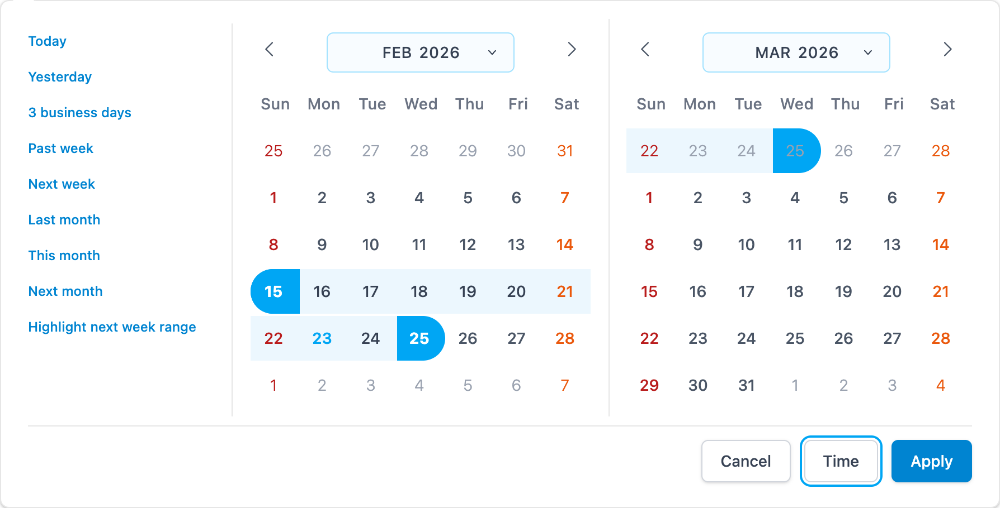
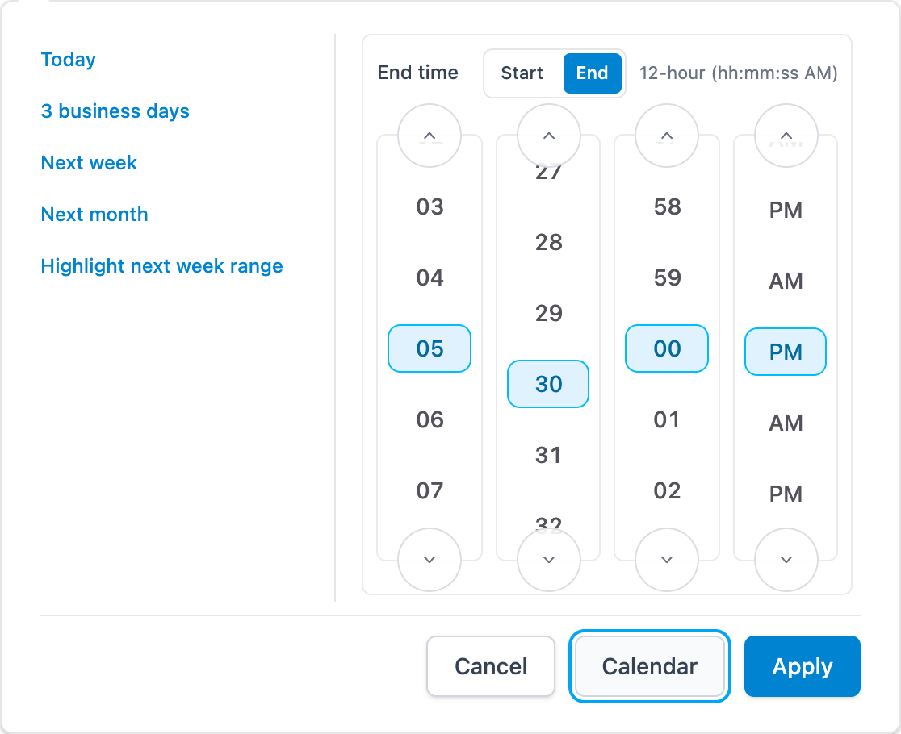
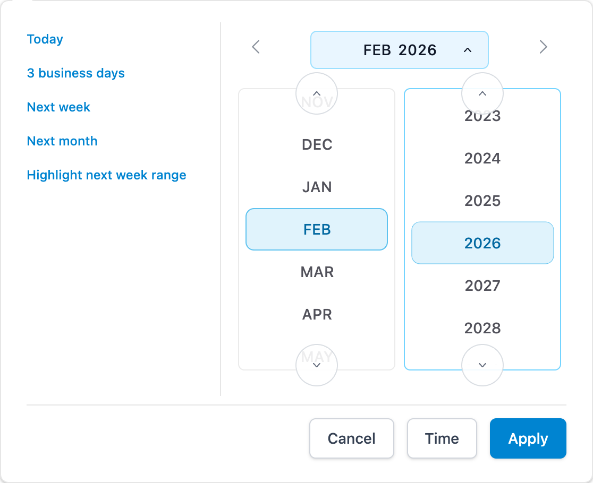

# Vue Tailwind Datepicker

<p align="center">
    <a href="https://github.com/ignatremizov/vue-tailwind-datepicker" target="_blank">
      
    </a><br><br>
    Advanced date-time picker with native-UI like wheels for Vue 3 using Tailwind and dayjs.
    <br />
    Maintained fork by Ignat Remizov.
</p>

[](http://commitizen.github.io/cz-cli/)

## Highlights

<p>
  
</p>
<p>
  
  
</p>

## Documentation

Go to [full documentation](https://github.com/ignatremizov/vue-tailwind-datepicker/tree/main/docs) or run `npm run docs:dev` locally.

Project guidelines:

- [Contributing](./CONTRIBUTING.md)
- [Code of Conduct](./.github/CODE_OF_CONDUCT.md)
- [Release Guide](./.github/RELEASE_GUIDE.md)

## Installation

⚠️ Vue Tailwind Datepicker uses Tailwind CSS (with the @tailwindcss/forms plugin) & Day.js under the hood, **you must install those packages** before.
See the repository docs for complete setup guides.

### Install via npm

```
npm install @ignatremizov/vue-tailwind-datepicker
```

### Install via yarn

```
yarn add @ignatremizov/vue-tailwind-datepicker
```

## Simple Usage

How it works,

```vue
<script setup>
import { ref } from 'vue'
import VueTailwindDatepicker from '@ignatremizov/vue-tailwind-datepicker'
import '@ignatremizov/vue-tailwind-datepicker/style.css'

const dateValue = ref([])
const formatter = ref({
  date: 'DD MMM YYYY',
  month: 'MMM',
})
</script>

<template>
  <div>
    <VueTailwindDatepicker v-model="dateValue" :formatter="formatter" />
  </div>
</template>
```

The published package now exposes its stylesheet explicitly. Import `@ignatremizov/vue-tailwind-datepicker/style.css` once in your app entry or alongside the first component usage.

## Time Picker Modes

Use `timePickerStyle` to control whether time is disabled, text input, or wheel UI.

- `timePickerStyle="none"` (default): date-only mode.
- `timePickerStyle="input"`: text input time under the calendar.
- `timePickerStyle="wheel-inline"`: wheel controls always visible under the calendar.
- `timePickerStyle="wheel-page"`: calendar and wheel shown as separate pages.
- `timePageMode="toggle"` (default): manual page switching.
- `timePageMode="after-date"`: automatically switch from calendar to time after date selection.
- For any non-`none` mode, commit requires explicit **Apply** even when `autoApply=true`.
- `formatter.date` remains the source of truth for date/time parse and format behavior.

### Input mode

```vue
<script setup>
import { ref } from 'vue'

const value = ref('')
</script>

<template>
  <vue-tailwind-datepicker
    v-model="value"
    as-single
    time-picker-style="input"
    :auto-apply="true"
    :formatter="{ date: 'YYYY-MM-DD HH:mm', month: 'MMM' }"
  />
</template>
```

### Range with defaults

```vue
<script setup>
import { ref } from 'vue'

const value = ref({
  startDate: '',
  endDate: '',
})
</script>

<template>
  <vue-tailwind-datepicker
    v-model="value"
    use-range
    as-single
    time-picker-style="wheel-inline"
    default-time="09:00"
    default-end-time="17:00"
    :formatter="{ date: 'YYYY-MM-DD h:mm A', month: 'MMM' }"
  />
</template>
```

### Notes

- Existing date-only integrations do not need changes.
- If you enable a time mode (`input`, `wheel-inline`, `wheel-page`), ensure `formatter.date` includes time tokens (`HH:mm`, `HH:mm:ss`, or 12-hour equivalents with meridiem).
- If incoming model values do not include time, hydration uses `defaultTime` / `defaultEndTime` then falls back to `00:00[:00]`.

### Wheel modes

- `timePickerStyle="wheel-inline"`: native-like wheel selectors (`hh/mm[/ss]`, plus meridiem in 12-hour mode), always visible.
- `timePickerStyle="wheel-page"` with `timePageMode="toggle"`: manual back-and-forth using the switch button.
- `timePickerStyle="wheel-page"` with `timePageMode="after-date"`: flow is `calendar -> time -> apply`.
- `timeWheelScrollMode="boundary"` (default): wheels snap discretely at each unit.
- `timeWheelScrollMode="fractional"`: wheels drift continuously based on lower-order units (for example hour drift by minute progress).

```vue
<vue-tailwind-datepicker
  v-model="value"
  as-single
  time-picker-style="wheel-page"
  time-page-mode="after-date"
  time-wheel-scroll-mode="fractional"
  :formatter="{ date: 'YYYY-MM-DD HH:mm', month: 'MMM' }"
/>
```

## Native Scroll Selector Mode

Enable native-like month/year scrolling with `selectorMode` (use `:selector-mode` in templates). Default is `false`.

**Single date**

```vue
<script setup>
import { ref } from 'vue'

const singleDate = ref('')
</script>

<template>
  <vue-tailwind-datepicker v-model="singleDate" as-single :selector-mode="true" />
</template>
```

**Range**

```vue
<script setup>
import { ref } from 'vue'

const rangeDate = ref({
  startDate: '',
  endDate: '',
})
</script>

<template>
  <vue-tailwind-datepicker v-model="rangeDate" use-range :selector-mode="true" />
</template>
```

**Selector behavior options**

- `selector-year-scroll-mode="boundary"`: clarity-first default; year wheel advances discretely.
- `selector-year-scroll-mode="fractional"`: continuous month-synced year-wheel drift.
- `:selector-year-home-jump="100"`: Home key jump size (years) in year wheel mode.
- `:selector-year-end-jump="100"`: End key jump size (years) in year wheel mode.
- `:selector-year-page-jump="10"`: PageUp/PageDown jump size (years) in year wheel mode.
- `:selector-year-page-shift-jump="100"`: Shift+PageUp/Shift+PageDown jump size (years).
- `:selector-focus-tint="false"`: keeps selector containers neutral while preserving functionality.
- `:close-on-range-selection="false"`: keeps the popover open after selecting the second range date.
  Recommended with `selector-mode` when you want a fully native-like keep-open flow.
  In `no-input` static mode this option is a no-op because there is no popover to close.

**Popover behavior options**

- `open-focus-target="input" | "calendar"`: controls where focus lands after popover open.
- `:popover-transition="true|false"`: toggles enter/leave transition classes.
- `:popover-restore-focus="false"` (default): prevents automatic refocus of the input/trigger when the popover closes.
  Set `:popover-restore-focus="true"` to restore legacy trigger-refocus behavior.

```vue
<vue-tailwind-datepicker
  v-model="rangeDate"
  use-range
  :selector-mode="true"
  selector-year-scroll-mode="boundary"
  :selector-year-home-jump="100"
  :selector-year-end-jump="100"
  :selector-year-page-jump="10"
  :selector-year-page-shift-jump="100"
  :selector-focus-tint="true"
  :close-on-range-selection="false"
  open-focus-target="input"
  :popover-transition="true"
  :popover-restore-focus="false"
/>
```

**Template ref API (stable integration)**

For host flows that need imperative focus/readiness control, use the component ref API instead of querying internal `.vtd-*` selectors:

- `isReady(): boolean`
- `waitForReady(options?): Promise<boolean>`
- `focusCalendar(options?): Promise<boolean>`
- `focusInput(options?): boolean`

`waitForReady` is event-driven with a timeout fallback. Use `timeoutMs` (or legacy `maxAttempts`/`retryDelayMs`).

```vue
<script setup lang="ts">
import VueTailwindDatepicker from '@ignatremizov/vue-tailwind-datepicker'
import { ref } from 'vue'

type DatePickerRef = InstanceType<typeof VueTailwindDatepicker>

const pickerRef = ref<DatePickerRef | null>(null)
const rangeDate = ref({
  startDate: '',
  endDate: '',
})

async function focusCalendarAfterOpen() {
  const ready = await pickerRef.value?.waitForReady({ timeoutMs: 400 })
  if (ready)
    await pickerRef.value?.focusCalendar({ preventScroll: true })
}
</script>

<template>
  <VueTailwindDatepicker ref="pickerRef" v-model="rangeDate" use-range />
</template>
```

Selector wheel visuals are also themeable through CSS variables on `.vtd-datepicker` (month/year selected and hover colors, borders, typography, wheel cell sizing, and shared selected/unselected wheel text tokens used by selector + time wheels). Calendar range preview colors/opacity are exposed via `--vtd-calendar-range-preview-bg` and `--vtd-calendar-range-preview-bg-dark`. See `docs/theming-options.md` for examples.

## Shortcut Layout Customization

Shortcut sizing can be customized through the `shortcut-item` slot and host CSS.

```vue
<vue-tailwind-datepicker v-model="dateValue" :shortcuts="typedShortcuts">
  <template #shortcut-item="{ id, label, isDisabled, disabledReason, activate }">
    <button
      type="button"
      class="vtd-shortcuts w-[10.5rem] rounded border px-2 py-1.5 text-left text-sm"
      :data-shortcut-id="id"
      :disabled="isDisabled"
      @click="activate"
    >
      {{ label }}
    </button>
    <small v-if="disabledReason === 'blocked-date'">blocked by disableDate</small>
  </template>
</vue-tailwind-datepicker>
```

- Control width/spacing/typography with slot classes.
- Use `.vtd-shortcuts` for host-level CSS overrides.
- Use `disabledReason` (`explicit` | `blocked-date`) to show user-facing status badges.
- There is no dedicated `shortcutPanelWidth` prop yet; panel width follows rendered shortcut content.

## Weekend Day Styling Hooks

Day cells now expose stable weekend hooks so host apps can apply weekend tinting without patching component internals:

- `vtd-weekend` for Saturday and Sunday
- `vtd-saturday` for Saturday only
- `vtd-sunday` for Sunday only

```css
/* Base weekend tint */
.vtd-datepicker-date.vtd-weekend {
  color: #dc2626;
}

/* Optional split palette */
.vtd-datepicker-date.vtd-saturday {
  color: #ea580c;
}

.vtd-datepicker-date.vtd-sunday {
  color: #b91c1c;
}
```

Hooks are stable across locales and also apply when `selector-mode` is enabled:

```vue
<vue-tailwind-datepicker v-model="rangeEn" use-range i18n="en" />

<vue-tailwind-datepicker v-model="rangeDe" use-range i18n="de" />

<vue-tailwind-datepicker
  v-model="rangeSelector"
  use-range
  as-single
  :selector-mode="true"
  i18n="en"
/>
```

Hooks are additive: selected/range/disabled/today semantics remain unchanged unless your host CSS explicitly overrides them.

## Highlighted Day Hooks

Use `highlightDates` to mark specific calendar days with a stable hook class.

```vue
<script setup>
import dayjs from 'dayjs'
import { ref } from 'vue'

const value = ref('2025-06-15 00:00:00')
const highlightedDates = [
  new Date(2025, 5, 7),
  '2025-06-15',
  dayjs('2025-06-21'),
]
</script>

<template>
  <vue-tailwind-datepicker
    v-model="value"
    as-single
    :highlight-dates="highlightedDates"
  />
</template>
```

- `highlightDates` accepts an array of `Date`, `dayjs`, or strings matching the configured `formatter.date` or its date-only form.
- Matching is date-only (`YYYY-MM-DD`), so time values are ignored.
- Matching cells receive the `vtd-highlighted` class.

```css
.vtd-datepicker-date.vtd-highlighted {
  color: #0f766e;
}
```

The hook is additive, so highlighted cells still keep their normal selected/range/disabled/today behavior unless your host CSS overrides it.

## Direct Year Input (Selector Mode)

Use `directYearInput` to allow typing a year directly in selector mode. The feature is opt-in and defaults to `false`.

```vue
<script setup>
import { ref } from 'vue'

const value = ref({
  startDate: '',
  endDate: '',
})
</script>

<template>
  <vue-tailwind-datepicker
    v-model="value"
    use-range
    :selector-mode="true"
    :direct-year-input="true"
    year-numbering-mode="historical"
  />
</template>
```

Behavior summary:

- Valid typed tokens commit immediately to selector/calendar state and emit `update:modelValue` for the active context.
- Year parsing supports signed `-99999..99999`; `year-numbering-mode="historical"` rejects `0`, while `astronomical` accepts `0`.
- Typeahead intentionally supports historical/fantasy/scientific timelines (not only modern Gregorian UI assumptions):
  - Prefix `1` anchors to `1950` for 1-digit starts.
  - Prefix `2` anchors to the current year suffix for 1-digit starts.
  - 2-digit tokens use a mid-century suffix (`xx50`).
  - 3-digit non-zero prefixes use a mid-decade suffix (`xxx5`).
  - Up to 5 digits are accepted before the token resets.
  - `+` / `-` set explicit sign, `Backspace` edits the active token, and `Escape` clears it.
  - Typeahead state auto-resets after 900 ms of idle time.
- Enter confirms in place and keeps selector mode open.
- Escape and invalid blur revert to the last valid year text.
- In range mode, temporary `start > end` from live typing is allowed and is normalized only at explicit persist boundaries (`Apply` or close-with-persist toggle).
- Cancel-like exits (Escape, Cancel button, backdrop dismiss) do not trigger range normalization.

## Theming options

**Light Mode**


**Dark Mode**


## Local Dev Ports

- `npm run dev` uses Vite dev-server defaults (typically `http://127.0.0.1:5173/` unless overridden).
- `npm run preview` runs on `http://127.0.0.1:4173/` (configured in `package.json`).
- `npm run docs:screenshots` accepts a base URL argument, for example:
  - `npm run docs:screenshots -- http://127.0.0.1:5173/`
  - `npm run docs:screenshots -- http://127.0.0.1:4180/` (useful when working across multiple worktrees).
  - Screenshot quality is configurable via env vars:
    - `DOC_SCREENSHOT_VIEWPORT_WIDTH` (default `1800`)
    - `DOC_SCREENSHOT_VIEWPORT_HEIGHT` (default `1300`)
    - `DOC_SCREENSHOT_DEVICE_SCALE` (default `2`)
    - `DOC_SCREENSHOT_ZOOM` (default `1.0`)
- `npm run docs:videos` generates MP4 animation captures (same URL argument pattern):
  - `npm run docs:videos -- http://127.0.0.1:5173/`
  - `npm run docs:videos -- http://127.0.0.1:4180/`

## Dependency Pins (Dev)

- Maintainer builds and CI workflows use Node 24.22.1 and the npm version declared in root/docs `packageManager` (12.2.1). Workflows bootstrap that exact npm version with `--ignore-scripts` before installing dependencies under the reviewed policy, including when the runner initially has npm 11. Pull requests validate install policy, lint, library declarations, types, unit tests, packaged-entry tests, and documentation builds without running release steps. This tooling pin does not narrow the library's consumer peer dependencies.
- `@headlessui/vue` is pinned to the fork's GitHub release tarball `1.7.24-iremizov.3`, retaining the Vue fixes not yet available in the upstream npm line used by this repo. Headless UI is bundled into the published datepicker, so consumers receive this update with the next datepicker release.
- `js-beautify` now resolves to registry 2.0.3 through `@vue/test-utils`' declared `^2.0.0` dependency. Its upstream dependency modernization makes the old Git security override unnecessary. Test-utils bundles its HTML formatter, and this repo has no direct Angular `@let` or escaped Unicode formatter configuration requiring the fork's additional fixes. Exact HTML, raw output, and diagnostic formatting tests passed unchanged before and after removing the override.
- The npm CLI used by `@semantic-release/npm` is pinned to 12.2.1 as well. The plugin's version/pack preparation path is tested against that CLI in an isolated fixture without publishing.
- The separate docs package overrides only VitePress's Vite dependency to `^6.4.5`. Stable VitePress 1.6.4 still requests Vite 5, while its Vue plugin supports Vite 6. This keeps the existing documentation setup on a patched Vite line without adopting VitePress 2 prereleases. Recheck `npm run docs:build` and the interactive `/demo.html` page when changing this override.
- When updating the Headless UI fork pin, prefer a tagged release or commit SHA URL and run:
  - `npm install`
  - `npm run test:unit`
  - `npm run build`
  - `npm audit`

### Install-script policy

Root and docs each have their own `.npmrc` and `allowScripts` policy. `strict-allow-scripts=true` rejects unreviewed dependency lifecycle scripts, and `strict-npmrc=true` rejects unknown configuration keys instead of silently ignoring a typo. Use npm 12.2.1 for maintainer installs; npm 11 does not enforce the same strict policy.

- Root approves only `esbuild@0.28.2` and `vue-demi@0.14.10`; docs approves only `esbuild@0.25.12` and `vue-demi@0.14.10`. Their scripts select/validate the platform binary and install the Vue compatibility shim, respectively.
- Both explicitly deny `fsevents@2.3.3` install scripts. Its distributed archive includes a prebuilt native module and no build inputs or install hook, although registry metadata advertises a native rebuild. No native rebuild is needed or approved.
- Root uses `allow-remote=root` for the direct, pinned Headless UI release tarball. Docs denies remote packages, and both projects deny Git sources. No blanket script or remote-source allowance is enabled.

After changing a dependency, inspect `npm install-scripts ls` and `npm --prefix docs install-scripts ls`. Review the actual scripts before approving a specific package with `npm install-scripts approve <package>` (or the docs-prefixed command), which writes an exact-version approval by default. Update the policy deliberately when a reviewed version changes, and rerun `npm run test:npm-policy`, both clean installs, and the normal build/test gates. Do not use approve-all or disable strict enforcement to make an install pass. Root-owned project hooks, such as the library's prepack build, still run normally.

The previously reported [braces stack-exhaustion advisory](https://github.com/advisories/GHSA-vfj7-8cjw-p6xm) was withdrawn on October 23, 2026, because it was not practically exploitable. The October 25 refresh started with no findings in the full root, production-only, or separate docs dependency trees. The compatible lockfile updates are maintenance changes, not a fix for the withdrawn report, and no override or suppression was added. Continue checking the complete tree with `npm audit`, the runtime tree with `npm audit --omit=dev`, and documentation tooling with `npm --prefix docs audit`.

## Changelog

All notable changes to this project will be documented in the [Releases Page](https://github.com/ignatremizov/vue-tailwind-datepicker/releases).

## Funding

- [GitHub Sponsors: @ignatremizov](https://github.com/sponsors/ignatremizov)

## License

The [MIT](LICENSE) License. Please [see](http://opensource.org/licenses/MIT) for more information.

## Contributors

- [Ignat Remizov](https://github.com/ignatremizov) (maintainer of this fork)
- [Alexandre Le Corre](https://github.com/elreco) (upstream maintainer)
- [Kenhyuwa](https://github.com/kenhyuwa) (original author/contributor)
- See [CONTRIBUTORS.md](./CONTRIBUTORS.md) for contributor notes.
- [Vue](https://v3.vuejs.org/)
- [Tailwind CSS](https://tailwindcss.com/)
- [day.js](https://day.js.org/)
- and other support...
